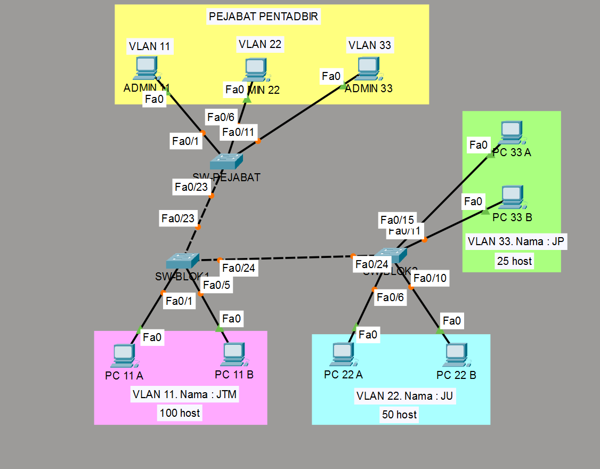

# 🏆 Final Practical Assessment: Internetworking Protocols (DKB2332)
### 🎓 Diploma in Information Technology — Cyber City College (Perfect Completion Score: 66/66)

---

## 📌 1. Project Overview
This repository contains the configuration work for the Final Practical Assessment of the **DKB2332 Internetworking Protocols** course. The objective of this project was to design and deploy a scalable enterprise network infrastructure to connect two (2) newly constructed building blocks with the main Administration Office for Cyber City College.

The network implements **Variable Length Subnet Mask (VLSM)** layout algorithms starting from a base network pool of `192.168.0.0/24` alongside **VLAN Segmentation** and **VLAN Trunking Protocol (VTP)** frameworks to minimize broadcast domains and optimize intra-organizational traffic flow.

---

## 📊 2. Network Topology Diagram
Below is the verified enterprise network architectural layout designed and fully simulated using Cisco Packet Tracer:

---

## 📝 3. System Documentation & Design Specifications

### 🧮 A. IPv4 Network Addressing Plan (VLSM Subnetting)
The subnetwork constraints were precisely budgeted based on the specific host scale requirements for each structural department:
* **Information Technology Department (VLAN 11):** 100 Hosts Required
* **General Department (VLAN 22):** 50 Hosts Required
* **Business Department (VLAN 33):** 25 Hosts Required

### 🔄 B. VLAN Trunking Protocol (VTP) Domain Setup
A VTP management framework was successfully implemented to automate database propagation from the central core switch down to the access-layer structural building blocks.

| Switch Hostname | VTP Operational Mode | VTP Domain Name | VTP Authentication Password |
| :--- | :--- | :--- | :--- |
| `SW-PEJABAT` | **Server** | `City.com` | `City1234` |
| `SW-BLOK1` | **Client** | `City.com` | `City1234` |
| `SW-BLOK2` | **Client** | `City.com` | `City1234` |

### 🏢 C. VLAN Mapping & Port Assignments

| Switch Hostname | Logical Interface Access Ports | Assigned VLAN ID | Department Name | Structural Role |
| :--- | :--- | :--- | :--- | :--- |
| **SW-PEJABAT** | `Fa0/1`   `Fa0/6`   `Fa0/11` | VLAN 11   VLAN 22   VLAN 33 | JTM   JU   JP | Admin 11 Core   Admin 22 Core   Admin 33 Core |
| **SW-BLOK1** | `Fa0/1 - Fa0/5` | VLAN 11 | JTM | IT Department Hosts |
| **SW-BLOK2** | `Fa0/6 - Fa0/10`   `Fa0/11 - Fa0/15` | VLAN 22   VLAN 33 | JU   JP | General Dept Hosts   Business Dept Hosts |

*Note: Inter-switch trunk lines linking `SW-PEJABAT` (via ports `Fa0/23` & `Fa0/24`) to the access layer switches are explicitly configured with standard **IEEE 802.1Q encapsulation**.*

---

## 🔒 4. Switch Infrastructure Security Hardening
To safeguard the local control and management planes, baseline infrastructure security parameters were deployed across all active switches via the Cisco IOS CLI:
1. **Device Hostname Schema:** Configured systematically as `SW-PEJABAT`, `SW-BLOK1`, and `SW-BLOK2`.
2. **Privileged EXEC Mode Hardening:** Protected with strong MD5 cryptographic hashing via the `enable secret EnCity` directive.
3. **Physical Boundary Security:** Secured native asynchronous access points using a strict `line console 0` password string (`ConCity`).
4. **Data Privacy Control:** Executed global `service password-encryption` parameters to eliminate plaintext configuration liabilities (`show running-config`).

---

## 🧪 5. End-to-End Connectivity Verification (Ping Validation)
Layer 3 boundaries and logical VLAN segments were verified using native terminal command prompt utilities, resulting in **100% data transmission validation (0% packet loss)**:

* **PING from ADMIN 11 ➔ PC 11 A** (`192.168.0.5`) ➔ **SUCCESSFUL ✅**
* **PING from ADMIN 22 ➔ PC 22 A** (`192.168.0.133`) ➔ **SUCCESSFUL ✅**
* **PING from ADMIN 33 ➔ PC 33 A** (`192.168.0.197`) ➔ **SUCCESSFUL ✅**

---
*Developed as part of the core practical assessment requirements for the DKB2332 Internetworking Protocols course, Diploma in Information Technology.*
